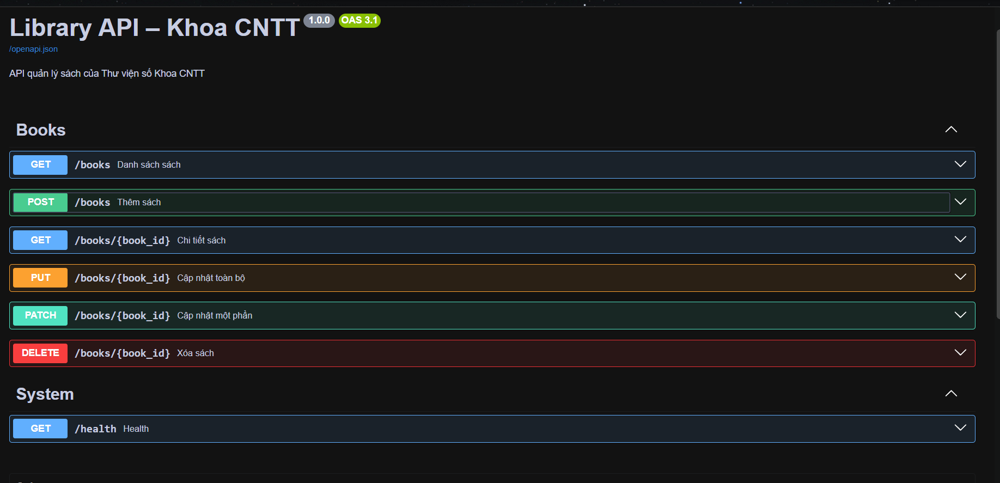
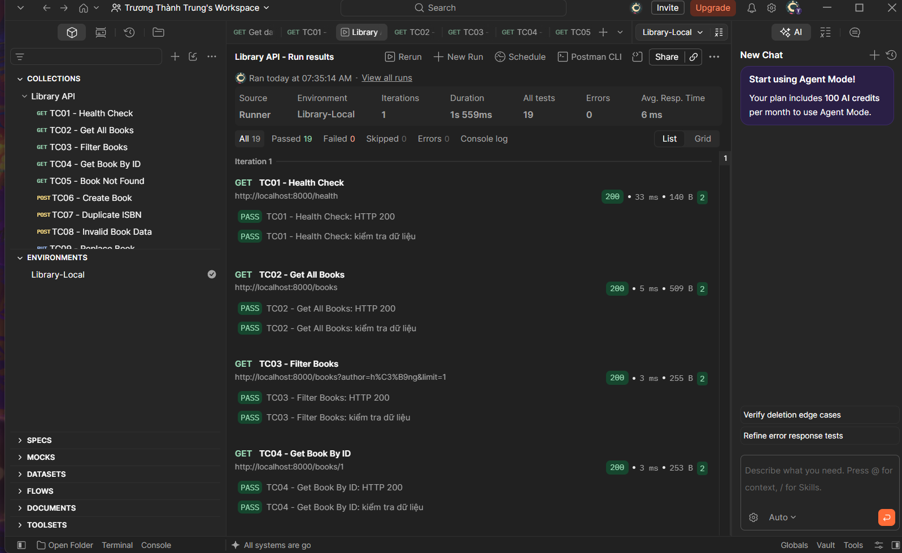

# Library API – Khoa CNTT

**Lab 4 – Xây dựng Web API CRUD với FastAPI và kiểm thử bằng Postman**

Dự án minh họa một REST API quản lý sách cho thư viện. API hỗ trợ xem danh sách, tìm kiếm/lọc, phân trang, xem chi tiết, thêm, thay thế, chỉnh sửa một phần và xóa sách. Giao diện kiểm thử tự động được cung cấp qua Swagger UI và bộ Postman Collection.

## 1. Công nghệ sử dụng

- Python 3.10 trở lên (mã nguồn sử dụng cú pháp `int | None`)
- FastAPI, Pydantic, Uvicorn
- Postman để kiểm thử API
- Git/GitHub để quản lý phiên bản

**Lưu ý:** Dữ liệu sách được lưu trong danh sách Python (`app/data.py`), **không sử dụng cơ sở dữ liệu**. Khi khởi động lại tiến trình server, những thay đổi qua POST/PUT/PATCH/DELETE có thể mất.

## 2. Cấu trúc thư mục

```text
library-api/
├── app/
│   ├── __init__.py
│   ├── main.py
│   ├── models.py
│   ├── data.py
│   └── routers/
│       ├── __init__.py
│       └── books.py
├── postman/
│   ├── Library-API.postman_collection.json
│   └── Library-Local.postman_environment.json
├── docs/
│   ├── swagger.png
│   └── postman_runner.png.png
├── requirements.txt
├── README.md
└── .gitignore
```

## 3. Cài đặt và chạy API

Ví dụ trên **Ubuntu / WSL**: mở Terminal tại thư mục gốc dự án (nơi có `requirements.txt`).

```bash
python3 -m venv .venv
source .venv/bin/activate
python -m pip install -r requirements.txt
python -m uvicorn app.main:app --host 0.0.0.0 --port 8000 --reload
```

Nếu `.venv` đã tồn tại, bỏ qua bước tạo môi trường và chỉ kích hoạt lại. Khi Terminal hiển thị `Application startup complete.`, mở:

- Swagger UI: http://127.0.0.1:8000/docs
- OpenAPI JSON: http://127.0.0.1:8000/openapi.json
- Kiểm tra hệ thống: http://127.0.0.1:8000/health

Giữ Terminal chạy server trong lúc kiểm thử. Nhấn `Ctrl + C` khi muốn dừng.

## 4. Các endpoint

| Phương thức | Đường dẫn | Chức năng | HTTP thành công |
| --- | --- | --- | --- |
| GET | `/health` | Kiểm tra hoạt động | 200 |
| GET | `/books` | Danh sách, lọc, phân trang | 200 |
| GET | `/books/{book_id}` | Lấy chi tiết một cuốn sách | 200 |
| POST | `/books` | Thêm sách mới | 201 |
| PUT | `/books/{book_id}` | Thay thế thông tin sách | 200 |
| PATCH | `/books/{book_id}` | Sửa một phần thông tin | 200 |
| DELETE | `/books/{book_id}` | Xóa sách | 204 |

Với `GET /books`, các tham số truy vấn gồm `q` (tìm theo tên), `author` (lọc theo tác giả), `skip` (bỏ qua bao nhiêu kết quả, mặc định 0) và `limit` (số kết quả, mặc định 10, tối đa 100).

Ví dụ tạo sách bằng `POST /books` (JSON):

```json
{
  "isbn": "9786040000059",
  "title": "Lập trình Web nâng cao",
  "author": "Nguyễn Văn An",
  "year": 2025,
  "quantity": 10
}
```

Ràng buộc chính: ISBN gồm đúng 13 chữ số, tên và tác giả không được rỗng, năm từ 1900 đến 2100, số lượng không âm. Các mã lỗi được kiểm thử bao gồm `404` (không tìm thấy), `409` (ISBN trùng) và `422` (dữ liệu không hợp lệ).

## 5. Kiểm thử bằng Postman

1. Giữ FastAPI chạy tại `http://127.0.0.1:8000`.
2. Trong Postman, **Import** hai file ở thư mục `postman/`.
3. Chọn Environment **Library-Local** và kiểm tra biến `baseUrl` là `http://127.0.0.1:8000`.
4. Chọn Collection **Library API** → **Run**.
5. Chọn kiểu chạy **Functional**, đủ 12 request theo thứ tự TC01–TC12, **Iterations = 1**, rồi **Start run**.
6. Xem phần **Run results**. Một số trường hợp cố ý trả `404`, `409` hoặc `422` để xác nhận hệ thống xử lý lỗi đúng.

| Test case | Nội dung | HTTP kỳ vọng |
| --- | --- | ---: |
| TC01 | Health Check | 200 |
| TC02 | Get All Books | 200 |
| TC03 | Filter Books | 200 |
| TC04 | Get Book By ID | 200 |
| TC05 | Book Not Found | 404 |
| TC06 | Create Book | 201 |
| TC07 | Duplicate ISBN | 409 |
| TC08 | Invalid Book Data | 422 |
| TC09 | Replace Book | 200 |
| TC10 | Patch Book | 200 |
| TC11 | Delete Book | 204 |
| TC12 | Verify Deleted | 404 |

**Kết quả kiểm thử đã ghi nhận:** 12 request, 19 lượt kiểm tra (**19 Passed, 0 Failed, 0 Errors**) trong lần chạy minh chứng của bài. Nếu đã thay đổi dữ liệu bằng Swagger hoặc chạy một phần Collection trước đó, hãy khởi động lại server để các test có dữ liệu ban đầu nhất quán.

## 6. Ảnh minh chứng

### Swagger UI



### Postman Collection Runner



## 7. Hướng dẫn Git/GitHub

Mã nguồn và file kiểm thử được lưu trong Repository này. Quy trình thực hành sử dụng hai nhánh `main` và `feature/books-api`, tạo Pull Request từ nhánh tính năng sang `main` để xem xét và lưu lịch sử thay đổi. Không đưa thư mục `.venv`, `__pycache__` hoặc file chứa mật khẩu/token vào Git.

**Ghi chú:** File minh chứng Postman đang được giữ nguyên tên `postman_runner.png.png` theo tên hiện có trong Repository.
